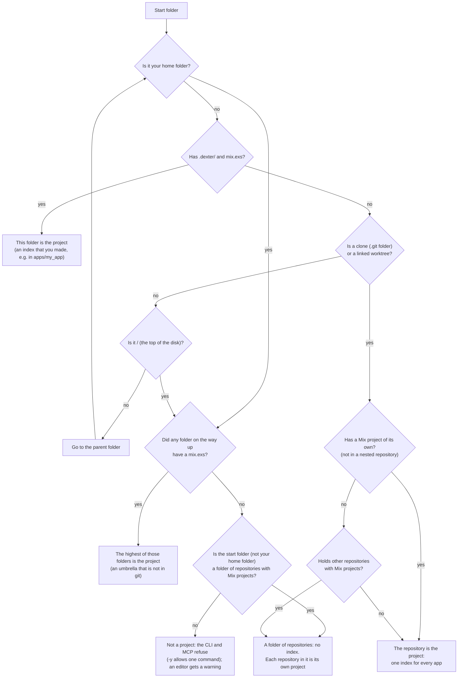

# Dexter


A fast, full-featured Elixir LSP optimized for large Elixir codebases.

## Table of contents

- [Features](#features)
- [Quick start](#quick-start)
  - [Run the latest main](#run-the-latest-main)
- [Editor setup](#editor-setup)
  - [VS Code / Cursor](#vs-code--cursor)
    - [Configuration](#configuration)
  - [Neovim (0.11+)](#neovim-011)
    - [Configuring format on save](#configuring-format-on-save)
  - [Neovim (with nvim-lspconfig — \< 0.11)](#neovim-with-nvim-lspconfig---011)
  - [Zed](#zed)
  - [Claude Code](#claude-code)
  - [Emacs](#emacs)
    - [Eglot](#eglot)
      - [Emacs version \>= 30](#emacs-version--30)
      - [Emacs version \<= 29](#emacs-version--29)
    - [lsp-mode](#lsp-mode)
  - [Helix](#helix)
- [Why build another LSP?](#why-build-another-lsp)
- [Performance](#performance)
- [CLI usage](#cli-usage)
  - [Index a project](#index-a-project)
  - [Look up definitions](#look-up-definitions)
  - [Find references](#find-references)
  - [Reindexing files manually](#reindexing-files-manually)
- [MCP server](#mcp-server)
- [Hover documentation](#hover-documentation)
  - [Cursor-position-aware resolution](#cursor-position-aware-resolution)
- [Rename](#rename)
  - [Modules](#modules)
  - [Functions](#functions)
  - [Variables](#variables)
  - [Renaming with several editors](#renaming-with-several-editors)
- [Lightning-fast formatting](#lightning-fast-formatting)
- [LSP options](#lsp-options)
- [Index database location (.dexter/)](#index-database-location-dexter)
- [Workspace daemon](#workspace-daemon)
- [Debugging](#debugging)
- [Development (building from source)](#development-building-from-source)
- [Releasing](#releasing)
- [Contributing](#contributing)
- [License](#license)

## Features

- **Fast indexing** — cold index completes in ~11s on a 57k-file Elixir monorepo, ~100ms on Oban, ~300ms on the Elixir standard library (measured on an M1 MacBook Pro). After your first index, incremental indexing makes sure that you never have to reindex the whole codebase again.
- **Go-to-definition** — jump to any module, function, type, or variable definition. Resolves aliases, imports, `defdelegate` chains, `use` injections, and the Elixir stdlib. Handles all definition forms: `def`, `defp`, `defmacro`, `defprotocol`, `defimpl`, `defstruct`, and more.
- **Go-to-references** — find all usages of a function or module across the codebase, including through `import`, `use` chains, and `defdelegate`.
- **Hover documentation** — `@doc`, `@moduledoc`, `@typedoc`, and `@spec` annotations rendered as Markdown when you hover over a symbol.
- **Autocompletion** — modules, functions, types, and variables with full snippet support. Resolves through aliases, imports, `use` injections, and the Elixir stdlib. Works for qualified calls (`MyApp.Accounts.|`), bare function calls, and module prefixes.
- **Rename** — rename modules, functions, and variables with automatic file renaming when the convention is followed.
- **No compilation required** — the index is built by parsing source files directly, not by compiling your project. Dexter works immediately on any codebase, even ones that don't compile.
- **Macro-generated functions** — when your project is compiled, completion, hover, and go-to-definition also find functions that macros generate (for example Phoenix route helpers). Dexter reads them from the compiled `.beam` files in `_build`. Compilation stays optional.
- **Monorepo and umbrella support** — a single index at the repository root covers all apps and shared libraries. Go-to-definition, find references, and rename work cross-project out of the box.
- **Format on save** — formats `.ex`, `.exs`, and `.heex` files on save via a persistent Elixir process. Near-instant after the first save. Formatter plugins (Styler, Phoenix.LiveView.HTMLFormatter) are loaded from your project's `_build` — no install needed. Syntax errors are surfaced as diagnostics.
- **Elixir stdlib indexing** — jump to `Enum`, `String`, `Mix`, and other bundled modules by indexing your local Elixir installation sources.
- **Signature help** — parameter hints as you type function calls.
- **Workspace symbols** — search for any module or function across the entire codebase.
- **Call hierarchy** — navigate incoming and outgoing calls.
- **Go-to-implementation** — find the modules that implement a behaviour or a protocol.
- **Code actions** — add missing aliases with a single action.
- **Document symbols** — outline view of all functions and modules in the current file.
- **Document highlight** — highlight all occurrences of the symbol under the cursor.
- **Variable support** — go-to-definition, rename, and completion for local variables via tree-sitter, with correct scoping across `case`, `with`, `for`, and other block constructs.
- **Git branch switch detection** — automatically reindexes when you switch branches.
- **One index for every tool** — your editors, the CLI, and AI agents share one [workspace daemon](#workspace-daemon) per project, so they all answer from the same index.
- **MCP server for AI agents** — `dexter mcp` gives agents the same navigation and rename as your editor. See [MCP server](#mcp-server).

<details>
<summary>More features</summary>

- **Delegate following** — `defdelegate fetch_user(id), to: MyApp.Accounts.Finders.FetchUser, as: :find` jumps to `MyApp.Accounts.Finders.FetchUser.find`, respecting `as:` renames.
- **Alias resolution** — `alias MyApp.Handlers.Foo`, `alias MyApp.Handlers.Foo, as: Cool`, `alias MyApp.Handlers.{Foo, Bar}`.
- **Import resolution** — bare function calls resolved through `import` declarations.
- **Type definitions** — `@type` and `@opaque` are indexed for go-to-definition and hover.
- **Folding ranges** — collapse functions and modules in your editor.
- **Monorepo-aware formatting** — walks up from the file to find the nearest `.formatter.exs`, so subprojects with their own formatter configs (including nested `subdirectories:` configs) just work.
- **Heredoc awareness** — code examples in `@moduledoc`/`@doc` are skipped.
- **Module nesting** — correctly tracks `end` keywords to attribute functions to the right module.

</details>

## Quick start

1. **Install Dexter.** Pick one:

   ```sh
   # via mise
   mise use -g aqua:remoteoss/dexter@latest

   # via asdf
   asdf plugin add dexter https://github.com/remoteoss/dexter.git && asdf install dexter latest && asdf set --home dexter latest

   # via Homebrew
   brew install dexter-lsp
   ```

   Or [build from source](#development-building-from-source).

2. **Configure your editor** — see [Editor setup](#editor-setup) below.

3. **Open an Elixir project.** Dexter indexes the project automatically the first time your editor starts it.

### Run the latest main

To try changes before they are released, install the newest `main` branch with mise:

```sh
mise use -g asdf:remoteoss/dexter@main
```

The asdf plugin clones `main` and builds it on your machine. The build needs Go 1.26.1 (for example `mise use -g go@1.26.1`) and a C compiler, because Dexter uses SQLite through cgo. On macOS, `xcode-select --install` gives you a C compiler.

mise does not update this install by itself. To rebuild from the newest `main`:

```sh
mise install -f asdf:remoteoss/dexter@main
```

A build from `main` reports the number of the last release in `dexter version`. The `aqua:` backend installs only releases, so it cannot install `main`.

## Editor setup

Dexter works with any editor that supports the Language Server Protocol. Below are setup instructions for the most common ones — if your editor isn't listed, point it at `dexter lsp` over stdio.

### VS Code / Cursor

Install the [Dexter VS Code Extension](https://marketplace.visualstudio.com/items?itemName=remoteoss.dexter-lsp).

Or, if you prefer to install from source: [dexter-vscode](https://github.com/remoteoss/dexter-vscode?tab=readme-ov-file#development).

#### Configuration

If `dexter` is on your `PATH` (for example after an install with mise, asdf, or Homebrew), you do not need to configure anything.

If Dexter is not on your `PATH`, set the binary path in your editor settings:

```json
{
  "dexter.binary": "/Users/you/.local/share/mise/shims/dexter"
}
```

To enable format-on-save, update your VS Code/Cursor settings:

```json
// global in your editor
{
  "editor.formatOnSave": true,
}

// or, for Elixir specifically
{
  "[elixir]": {
      "editor.formatOnSave": true,
      // you may need to set Dexter as your default Elixir formatter, depending on your setup
      "editor.defaultFormatter": "remoteoss.dexter-lsp" // "remote-com-oss.dexter-lsp" for Cursor
  },
  "[phoenix-heex]": { "editor.formatOnSave": true }
}
```

### Neovim (0.11+)

Add to your LSP configuration (e.g., `after/plugin/lsp.lua`):

```lua
vim.lsp.config('dexter', {
  -- Start Dexter in the project of the file. Neovim starts a server in its own
  -- current folder, and Dexter finds the project from the folder it starts in.
  cmd = function(dispatchers, config)
    return vim.lsp.rpc.start({ 'dexter', 'lsp', config.root_dir }, dispatchers)
  end,
  root_markers = { 'mix.exs', '.git' },
  filetypes = { 'elixir', 'eelixir', 'heex' },
  init_options = {
    followDelegates = true,  -- jump through defdelegate to the target function
    -- stdlibPath = "",      -- override Elixir stdlib path (auto-detected)
    -- debug = false,        -- verbose logging to the LSP log (view with :LspLog)
  },
})

vim.lsp.enable 'dexter'
```

The root markers only need to find a folder inside the project. Dexter finds the project root from there, for example the root of a monorepo.

That's it. Go-to-definition (`gd`, `<C-]>`, or whatever you have mapped to `vim.lsp.buf.definition()`) will now use dexter alongside any other attached LSP servers.

If you want a dedicated binding just for dexter:

```lua
vim.keymap.set("n", "<leader>va", function()
  vim.lsp.buf.definition({ filter = function(client) return client.name == "dexter" end })
end)
```

#### Configuring format on save

If you want formatting on save, you'll need to configure a `PreWrite` autocmd. You can do something like this:

```lua
vim.api.nvim_create_autocmd('LspAttach', {
  group = vim.api.nvim_create_augroup('my.lsp', {}),

  callback = function(args)
    local opts = { remap = false }
    local client = assert(vim.lsp.get_client_by_id(args.data.client_id))
    local builtin = require("telescope.builtin")

    -- along with your other config

    if client:supports_method('textDocument/formatting') then
      -- the most important part
      vim.api.nvim_create_autocmd('BufWritePre', {
        buffer = args.buf,
        callback = function()
          vim.lsp.buf.format({ bufnr = args.buf, id = client.id, timeout_ms = 5000 })
        end,
      })
    end
  end
})
```

### Neovim (with nvim-lspconfig — < 0.11)

```lua
local lspconfig = require("lspconfig")
local configs = require("lspconfig.configs")

configs.dexter = {
  default_config = {
    cmd = { "dexter", "lsp" }, -- update this if you don't have Dexter in your PATH
    filetypes = { "elixir", "eelixir", "heex" },
    root_dir = lspconfig.util.root_pattern("mix.exs", ".git"),
  },
}

lspconfig.dexter.setup({})
```


### Zed

See the [Zed docs](https://zed.dev/docs/languages/elixir#using-dexter) for full details. Enable Dexter in your Zed `settings.json`:

```json
{
  "languages": {
    "Elixir": {
      "language_servers": ["dexter", "!elixir-ls", "!expert"]
    },
    "EEx": {
      "language_servers": ["dexter", "!elixir-ls", "!expert"]
    },
    "HEEx": {
      "language_servers": ["dexter", "!elixir-ls", "!expert"]
    }
  }
}
```

If `dexter` is already on your `PATH` (for example from [mise](https://mise.en.dev/)), the extension uses that binary and does not download one.

To override the binary path manually, add this to your `settings.json`:

```json
{
  "lsp": {
    "dexter": {
      "binary": {
        "path": "/Users/you/.local/share/mise/shims/dexter", // or wherever `which dexter` points to
        "arguments": ["lsp"]
      }
    }
  }
}
```

If Zed shows the warning *"could not find the Elixir standard library"*, point Dexter at the `lib` directory of an Elixir source tree that matches your Elixir version (for example a checkout of [elixir-lang/elixir](https://github.com/elixir-lang/elixir)). This is common when Elixir was installed with Homebrew, which ships no standard library sources:

```json
{
  "lsp": {
    "dexter": {
      "initialization_options": {
        "stdlibPath": "/path/to/elixir/lib"
      }
    }
  }
}
```

You can also set the `DEXTER_ELIXIR_LIB_ROOT` environment variable in `lsp.dexter.binary.env`. Then run `dexter stop` in the project and restart Zed, because a running daemon keeps the standard library that it found.

### Emacs

The emacs instructions assume you're using **use-package**.

#### Eglot

##### Emacs version >= 30

```emacs-lisp
(use-package eglot
  :ensure t

  :config
  (setf (alist-get '(elixir-mode elixir-ts-mode heex-ts-mode)
                   eglot-server-programs
                   nil nil #'equal)
        '("/path/to/dexter" "lsp")) ;; wherever `which dexter` points to

  ;; other config
  )
```

##### Emacs version <= 29

```emacs-lisp
(use-package eglot
  :ensure t

  :config
  (setf (alist-get 'elixir-mode eglot-server-programs)
        '("/path/to/dexter" "lsp")) ;; wherever `which dexter` points to

  ;; other config
  )
```

#### lsp-mode

```emacs-lisp
(use-package lsp-mode
  :ensure t
  :hook ((elixir-mode elixir-ts-mode heex-ts-mode) . lsp-deferred)
  :config
  (add-to-list 'lsp-disabled-clients 'elixir-ls)

  (lsp-register-client
   (make-lsp-client
    :new-connection (lsp-stdio-connection
                     '("/path/to/dexter" "lsp")) ;; wherever `which dexter` points to
    :activation-fn (lsp-activate-on "elixir")
    :server-id 'dexter-elixir)))
```

### Helix

Add to your LSP configuration in `~/.config/helix/languages.toml`:

```toml
[language-server.dexter]
command = "dexter"
args = ["lsp"]

[[language]]
name = "elixir"
language-servers = ["dexter"]
```

### Claude Code

[Claude Code](https://claude.ai/code) supports Dexter as an Elixir LSP via its plugin system, enabling go-to-definition, hover docs, find references, and more when working on `.ex`, `.exs`, and `.heex` files.

**Prerequisites:** The LSP tool must be enabled. Add this to your `~/.claude/settings.json`:

```json
{
  "env": {
    "ENABLE_LSP_TOOL": "1"
  }
}
```

**Install:**

```sh
claude plugin marketplace add remoteoss/dexter
claude plugin install dexter-lsp@dexter
```

That's it. Open an Elixir project in Claude Code and Dexter will handle go-to-definition, hover documentation, find references, and more.

## Why build another LSP?

Remote has one of the largest Elixir codebases in existence (at least that we're aware of), now around 57k files. As our codebase has grown, we've had more and more struggles with language servers. We had found that they simply couldn't keep up with such a large codebase. On large codebases like ours, existing LSPs take hours to index, and even after indexing, operations like go-to-definition and go-to-references are still slow. On top of that, changing branches means a whole new round of indexing. The result has been frustration. Many of us on the engineering team had all but given up on the idea of ever having a working LSP.

Dexter is designed with speed and efficiency as core guiding principles. It takes a different approach from other Elixir LSPs, parsing source files directly as text and storing everything in SQLite so lookups are fast. The speed difference is noticeable on codebases of all sizes. Although Dexter isn't fully aware of the compiled state of the code like compilation-based LSPs, some clever parsing and deferring complex macro following to runtime allow it to get very close. In fact, you probably wouldn't even notice this limitation if you weren't reading this.

## Performance

Measured on a 57k-file Elixir monorepo (330k definitions, 2.7M references) on a 32GB M1 MacBook Pro:

| Operation                     | Time  |
| ----------------------------- | ----- |
| Cold first-time index         | ~11s  |
| Lookup (LSP or CLI)           | ~10ms |
| Single file reindex (on save) | ~10ms |
| Full reindex (no changes)     | ~2s   |
| Format on save                | <1ms  |

## CLI usage

Use the CLI for scripts and for manual queries. `dexter --help` lists the commands, and `dexter <command> --help` lists the flags of a command.

Every command accepts `--root <path>` (or `-C <path>`). The command then runs as if
you started it in that directory. A shell, an agent, or an editor wrapper can
query a project from any directory:

```sh
# the flag goes anywhere on the command line
# note that relative paths, including the reindex target, resolve from the root
dexter --root ~/code/my-elixir-project lookup MyApp.Accounts fetch_user
dexter lookup --root ~/code/my-elixir-project MyApp.Accounts fetch_user
dexter reindex --root ~/code/my-elixir-project lib/my_app/accounts.ex
dexter lsp --root ~/code/my-elixir-project
dexter stop --root ~/code/my-elixir-project
```

`init`, `reindex`, `lookup`, and `references` refuse to run in a directory that is
not a project: your home directory, or a directory with no `mix.exs` or `.git` in it or
above it (see [how Dexter finds the project](#index-database-location-dexter)).
`init` checks only the directory that you give it, so give it the project root.
Thus a mistyped `dexter lookup` in your home directory stops, and does not build an
index of all your files. Pass `--root <path>` to name the project. If you really
mean that directory, pass `-y`/`--yes`. The flag applies to that one command only, so
add it each time. In a folder that holds several repositories, these commands also
refuse, and name the projects in it: run them in one of those projects.

`dexter lsp` does not refuse: the editor decides what the user opened, so Dexter
serves the directory and shows a warning in the editor.

### Index a project

```sh
# First time — indexes all .ex/.exs files (including deps/ and the Elixir standard library)
dexter init ~/code/my-elixir-project

# Re-init from scratch (deletes existing index)
dexter init --force ~/code/my-elixir-project

# Print timing breakdown for each indexing phase (walk, parse, store)
dexter init --profile ~/code/my-elixir-project
```

Dexter auto-detects your Elixir installation. If it can't find it (e.g. a non-standard install, it's not in your `PATH`, etc.), set:

```sh
export DEXTER_ELIXIR_LIB_ROOT="/path/to/elixir/lib"
```

The workspace daemon reads this variable when it starts. If a daemon is already running for the project, run `dexter stop` first.

### Look up definitions

```sh
# Find where a module is defined
dexter lookup MyApp.Accounts
# => /path/to/lib/my_app/accounts.ex:1

# Find where a function is defined (follows defdelegates by default)
dexter lookup MyApp.Accounts fetch_user
# => /path/to/lib/my_app/accounts/finders/fetch_user.ex:8

# Don't follow defdelegates
dexter lookup --no-follow-delegates MyApp.Accounts fetch_user
# => /path/to/lib/my_app/accounts.ex:5

# Strict mode — exit 1 if exact function not found (no fallback to module)
dexter lookup --strict MyApp.Accounts nonexistent
# => (exit code 1)
```

The first query in a project starts the [workspace daemon](#workspace-daemon), which builds the index if there is none. By default, a query answers at once from what is indexed, and prints a note to stderr while the index is still building. `lookup` and `references` accept two flags for this:

- `--wait <duration>` (for example `--wait 30s`): wait up to this long for the index to finish before answering.
- `-q`/`--quiet`: do not print the note. Setting the `DEXTER_QUIET=1` environment variable does the same.

### Find references

```sh
# Find all usages of a module
dexter references MyApp.Accounts
# => /path/to/lib/my_app_web/user_controller.ex:12
# => /path/to/lib/my_app/auth.ex:8

# Find all usages of a specific function
dexter references MyApp.Accounts fetch_user
# => /path/to/lib/my_app_web/user_controller.ex:45
```

Exits 1 with a message to stderr if no references are found.

### Reindexing files manually

Dexter keeps the index up to date for you. If you need to, you can reindex files manually with the CLI.

```sh
# Re-index a single file (~10ms)
dexter reindex /path/to/lib/my_app/accounts.ex

# Re-index the whole project (only re-parses changed files)
dexter reindex ~/code/my-elixir-project
```

While the workspace daemon runs, it automatically:

- Runs an incremental reindex when it starts
- Watches the project files, so it also indexes changes that other programs make (for example `git checkout` or an AI agent)
- Reindexes a file when your editor saves it
- Checks `.git/HEAD` for branch switches and reindexes when it finds one

## MCP server

Dexter includes a built-in [Model Context Protocol](https://modelcontextprotocol.io) server, modeled on `gopls mcp`. With it, AI agents navigate Elixir code through the index instead of grep. It has nine tools:

| Tool | What it does |
| --- | --- |
| `dexter_workspace` | Project layout, index state, and warnings |
| `dexter_search` | Find modules and functions by part of their name |
| `dexter_definition` | Where a module or function is defined, with its `@doc`, `@spec`, and source |
| `dexter_references` | Every call site, with the function or test that holds it; optionally the callees of a function |
| `dexter_module_api` | The public API of a module, including what a `use` injects |
| `dexter_file_outline` | What a file defines, with line numbers |
| `dexter_implementations` | Implementations of a behaviour or a protocol (including `@derive`) |
| `dexter_reindex` | Reindex now (only needed when file watching is not active) |
| `dexter_rename_symbol` | Rename a module or function in the whole project |

Register the server with your MCP client. For Claude Code:

```sh
claude mcp add dexter -- dexter mcp
```

Any client that speaks MCP over stdio works the same way: point it at `dexter mcp`.

**Which project the server uses.** The server asks the client for its workspace roots (MCP roots) and finds the project from them the same way the CLI does. So it uses the project that the client works in, not the directory that it was started from. When the client gives several roots, the server uses the first one that is a project. It refuses a root that is not a project, and your home directory. A client that gives no roots gets the directory that the server started in, if that is a project. To fix the project, give it as an argument (`dexter mcp <path>`) or with `--root`. With `--listen`, each client session finds its own project, so clients in different projects can share one server.

**A folder of repositories.** When the project is a folder that holds several repositories (clones and git worktrees), each tool takes a `project` argument: the directory of the checkout to ask, or a file in it. In any session, `project` can also name another checkout.

**Shared index.** `dexter mcp` connects to the [workspace daemon](#workspace-daemon), like `dexter lsp` and the CLI. It starts the daemon if necessary and keeps no index of its own. So the tools answer from the same index and caches as your editor. The daemon's file watcher indexes the changes that an agent writes. If the index is still building or cannot be fully used, the answer says so.

**Unsaved editor changes.** When an editor that uses the same daemon has a file open with unsaved changes (and the file on disk did not change after that), outlines, definition snippets, and reference lines come from the editor's text and its line numbers. The answer says so. The rename tool follows the rules in [Renaming with several editors](#renaming-with-several-editors): it writes a file that an editor has open without unsaved changes (the editor reloads it). If a file that it must change has unsaved changes in an editor, it changes nothing and names that file.

Useful variants:

```sh
# Serve over streamable HTTP instead of stdio (loopback addresses only; the
# server has no authentication, so another address needs --listen-unsafe)
dexter mcp --listen localhost:8092

# Print the agent-facing usage guide (save as context for clients that want it)
dexter mcp --instructions
```

## Hover documentation

Dexter serves hover docs (`textDocument/hover`) for functions, modules, and types. When you hover over a symbol, it looks up the definition in the index and reads the `@doc`, `@moduledoc`, `@typedoc`, or `@spec` annotations from the source file. For a function that a macro generates, which has no source, Dexter reads the documentation from the compiled module, if your project is compiled.

The hover response shows the function signature (with `@spec` if present), followed by the doc string:

```
def fetch_user(id, opts)
@spec fetch_user(binary(), keyword()) :: {:ok, User.t()} | {:error, term()}

Fetches a user by ID. Options are passed to the underlying query.
```

### Cursor-position-aware resolution

Dexter resolves hover (and go-to-definition) based on which segment of a dotted expression your cursor is on:

| Cursor position                              | Expression                  | Resolves to                  |
| -------------------------------------------- | --------------------------- | ---------------------------- |
| On `Accounts` in `MyApp.Accounts.list_users` | `MyApp.Accounts`            | The `MyApp.Accounts` module  |
| On `list_users` in `MyApp.Accounts.list_users` | `MyApp.Accounts.list_users` | The `list_users` function  |
| On `MyApp` in `MyApp.Accounts.list_users`    | `MyApp`                     | The `MyApp` module           |

## Rename

Dexter supports renaming modules, functions, and variables across the codebase via `textDocument/rename` (F2 in most editors).

### Modules

Place your cursor on any segment of a module name and invoke rename. Dexter highlights just the last segment for editing — the parent namespace is preserved automatically. For example, renaming `Accounts` in `MyApp.Accounts` to `Users` renames the module to `MyApp.Users`.

A use through an alias follows the alias. With `alias MyApp.Accounts`, the alias line changes to the new name, and `Accounts.get()` becomes `Users.get()`. When the new short name is already a name in that file (another alias, or a module), the alias line gets `as:` with the old short name, and the uses stay: `as:` changes one line and cannot change what the other name means. With an alias of a namespace above the module (`alias MyApp.Core` and `Core.Accounts`), the use keeps the alias when the new name is still in that namespace; otherwise it gets the full new name, and an alias line that then has no use is removed, because the compiler warns about an unused alias.

**What gets updated:**

- The `defmodule` declaration
- All aliases, imports, and uses referencing the module
- All call sites
- All submodules (renaming `MyApp.Foo` also renames `MyApp.Foo.Bar`, `MyApp.Foo.Baz`, etc.)

**File renaming after a module rename:** If the source file follows the Elixir naming convention (module `MyApp.Accounts` → file `accounts.ex`), dexter moves the file to the conventional path of the new name. The directories above the file that spell the namespace change with it: `lib/my_app/accounts/user.ex` for `MyApp.Accounts.User` goes to `lib/my_app/billing/user.ex` for `MyApp.Billing.User`, and to `lib/my_app/user.ex` for `MyApp.User`. Submodules in their own files move with the namespace (renaming `MyApp.Companies` to `MyApp.Clients` moves `lib/my_app/companies/services/do_something.ex` → `lib/my_app/clients/services/do_something.ex`). Dexter makes the new directories, and removes an old directory only when the move left it empty. A file whose directories do not spell the namespace keeps its directory and gets the new base name. After the rename, dexter opens the new file automatically if your editor supports `window/showDocument`.

**When path renaming won't happen:** If the file name doesn't match the snake_case form of the module's last segment — for example, a file named `my_custom_name.ex` that defines `MyApp.Accounts` — the file stays in place and only the contents are updated.

Files that no editor has open are written directly to disk; files open in an editor receive edits via the LSP workspace edit response (see [Renaming with several editors](#renaming-with-several-editors)).

### Functions

Place your cursor on a function name (qualified or bare) and invoke rename. Dexter updates:

- All `def`/`defp`/`defmacro`/`defguard`/etc. clauses
- `@spec` and `@callback` annotations
- Direct calls and pipe calls (`|> function_name`)
- `import Module, only: [function_name: ...]` lines
- Transitive call sites via `__using__` chains

**Behaviour callbacks.** A callback of a behaviour in your project is renamed with its whole family, from the `@callback` line or from any implementation: the `@callback`, every implementation in the project (modules with `@behaviour`, also through a `use` whose `__using__` adds it), their `@spec` lines, the `@optional_callbacks` and `defoverridable` entries, every call to them, and the calls through a variable in the behaviour module itself (`impl.perform(arg)`). Only the callback's arity is renamed. In a module whose implementation has default arguments, the arities that this definition gives are renamed too (`def go(x, opts \\ [])` implements `go/2` and also defines `go/1`, so the calls to that module's `go/1` change); in the other modules of the family, other arities of the same name stay. A definition whose default arguments also give a callback of another behaviour belongs to two families, and the rename is refused. A protocol function is renamed the same way: in the `defprotocol` and in every `defimpl` of the project. Dexter cannot know which module a variable holds elsewhere, so it does not rename such calls in other files; it tells you where they are.

Renaming is blocked for functions defined in stdlib or deps.

### Variables

Place your cursor on a local variable and invoke rename. Dexter uses tree-sitter to find all occurrences within the
enclosing function scope and renames them in a single edit. This is file-local only.

Go-to-definition also works for variables — it jumps to the first occurrence (pattern match or assignment) in scope.

### Renaming with several editors

Several editors can share one Dexter daemon. A rename never overwrites unsaved work in an editor, and never moves a file that another editor has open.

| File | Rename from your editor | Rename from an AI agent through MCP |
|---|---|---|
| Not open in any editor | Written to disk | Written to disk |
| Open in your editor | Edited in your editor | — |
| Open in another editor, no unsaved changes | Edited in your editor; save it there | Written to disk; the other editor reloads it |
| Open in another editor, unsaved changes | Edited in your editor; save it there | Refused |
| Must move, and another editor has it open | Refused | Refused |

The last column is for a rename that has no editor to apply edits: Dexter's MCP rename tool uses these rules.

When a file that another editor has open is edited in your editor, Dexter tells you which files to save. The other editor then sees an ordinary change on disk.

A buffer counts as having no unsaved changes when its text equals the file on disk, or differs only by one final newline or by CRLF against LF line endings (editors such as Neovim add the final newline on load).

When you save a file and rename at once, before Dexter has indexed the save (or right after a `git mv`, a `git checkout`, or a move in your editor), Dexter brings the index up to date itself before it renames. A refused rename changes no file. The messages (the paths are relative to the project), and what to do:

- `lib/my_app/beta.ex is open in another editor; close it there, then rename again.` — the rename must move that file. Close it in the other editor and rename again.
- `lib/my_app/beta.ex has unsaved changes in an editor; save or discard them there, then retry.` — save or discard the changes in that editor, then rename again.
- `the rename was not applied, because another editor opened lib/my_app/beta.ex while the rename ran.` — rename again.
- `the rename was not applied, because lib/my_app/beta.ex changed on disk while the rename ran.` — another program (for example `git checkout` or a formatter) changed the file. Rename again.
- `the rename was not applied, because lib/my_app/beta.ex changed in this editor since it was saved, and the index has the saved lines.` — save the file, then rename again.
- `the rename was not applied, because the index is behind the files: lib/my_app/beta.ex changed since Dexter indexed it, or is gone.` — Dexter could not index the file again (for example, it cannot read it). Make the file readable, then rename again.
- `the rename was not applied, because 250 files changed since Dexter indexed them; Dexter is probably still indexing a large change, such as a branch switch.` — wait until Dexter has indexed the change, then rename again.
- `the rename was not applied, because the index is still being updated after the last rename.` or `the rename was not applied, because Dexter is still indexing a change.` — wait a moment, then rename again.
- `the rename was not applied, because Dexter cannot write 1 of the files it must change: lib/my_app/beta.ex (permission denied).` — make the file (or, for a move, its directory) writable, then rename again.
- `the rename was not applied, because Dexter cannot create a temporary file in lib/my_app (permission denied), and it writes no file in place.` — make the directory writable, then rename again.
- `the rename was not applied, because lib/my_app/beta.ex is gone, and the file watcher has not reported it.` — if the file was moved, rename again in a moment; Dexter has removed it from the index.
- `the rename was not applied, because lib/my_app/gamma.ex appeared while the rename ran, and the rename must move a file there.` — another program made the file. Remove or rename it, then rename again.
- `the rename was not applied, because Dexter could not replace lib/my_app/beta.ex (input/output error). The files it had already replaced were restored; no file was changed.` — fix the cause, then rename again.
- `the rename was not applied, because handle_call/3 implements the GenServer behaviour from a dependency; Dexter cannot rename it.` — the behaviour is not in your project (a dependency, Elixir, or OTP), so its callback names are fixed.
- `the rename was not applied, because MyApp.Plugin, which implements MyApp.Worker.perform, is outside the project (in a dependency); Dexter cannot rename it.` — an implementation of your behaviour is in a dependency, which Dexter does not change.

Dexter cannot see a call whose function name is computed at run time or built by a macro in another module (for example `apply(module, :fetch, args)`, or a macro that generates `module.fetch(...)`). Such a call keeps the old name.

Files are written atomically: each new text goes to a temporary file next to the original, and then replaces the original in one step. A failed write (a full disk, for example) never leaves a file empty or half written. Dexter never writes a file in place.

A rename is all or nothing. If one file cannot be replaced, Dexter puts back every file it had already replaced, and the message says that no file was changed. Two rare cases can still leave a rename partly applied, and the message then names each file: a file system that has neither an atomic swap nor hard links (so Dexter keeps no copy of the old file), and a moved file whose old path cannot be removed at the end.

## Lightning-fast formatting

Dexter formats files through `textDocument/formatting`. To format on save, turn on format on save in your editor (see [Editor setup](#editor-setup)). A persistent Elixir process does the formatting, so it is near-instant after the first format. Each `.formatter.exs` gets its own formatter in that process, which loads the first time it formats a file.

Plugins ([`Styler`](https://github.com/remoteoss/elixir-styler), `Phoenix.LiveView.HTMLFormatter`, etc.) are loaded from
your project's `_build/dev/lib`. So as long as your formatter plugins are installed and compiled, everything is ready to
go.

**Non-standard formatter options:** Dexter passes your `.formatter.exs` options through to plugins as-is, matching `mix
format`. So plugin-specific options like `Phoenix.LiveView.HTMLFormatter`'s `:heex_line_length`, `:attribute_formatters`,
and `:inline_matcher` are honored. Like `mix format`, the formatter loads your `mix.exs` first, so `Mix.Project.config/0`
works. One caveat: the persistent process does not load your application config (`config/*.exs`), so a plugin that
reads it at format time with `Application.get_env/2` (e.g. `CanonicalTailwind` looking up its Tailwind binary)
won't see it — inline that config directly in `.formatter.exs` instead (e.g. `canonical_tailwind: [binary: "PATH"]`).

If the persistent process can't start, dexter falls back to running `mix format` directly.

**Syntax errors** found by the formatter are surfaced as LSP diagnostics pointing to the exact line and column, with a warning at the hint location (e.g. "the `do` on line 52 does not have a matching `end`"). Diagnostics clear on the next successful format (which again, is nearly instantaneous!).

**Nested `.formatter.exs`:** Dexter walks up from the file to the mix root and uses the nearest `.formatter.exs`. A file in `config/` uses `config/.formatter.exs` if it exists (for projects using `subdirectories:`), falling back to the root config.

**Elixir detection:** The `mix` and `elixir` binaries are derived from the same Elixir install used for stdlib detection, so the correct version is always used regardless of which tool manager you use (mise, asdf, etc.).

## LSP options

Dexter reads `initializationOptions` from your editor configuration:

- **`followDelegates`** (boolean, default: `true`): follow `defdelegate` targets on lookup.
- **`stdlibPath`** (string): override the Elixir stdlib directory to index. Defaults to auto-detection; use this if your install is non-standard. All editors of a project share one index, so the first editor that sets `stdlibPath` decides it until the daemon stops; an editor that sets another value is warned.
- **`debug`** (boolean, default: `false`): enable verbose logging for this editor session. Logs timing and resolution details for every definition, hover, references, and rename request to your editor's LSP log and to the workspace daemon's log (see [Debugging](#debugging)). You can also set the `DEXTER_DEBUG=true` environment variable; the workspace daemon reads it when it starts.
- **`maxTransientDocuments`** (integer, default: `50`): cap on how many lazily-loaded buffers the server retains in memory. When an LSP client (e.g. Claude Code) queries a file it never opened via `didOpen`, dexter reads it from disk and caches it. Editor-owned buffers are unaffected; only disk-loaded entries are subject to LRU eviction. Set to `0` to disable transient caching.

## Index database location (.dexter/)

Dexter keeps its index in `.dexter/dexter.db` at the root of the project. The folder has its own `.gitignore` (containing `*`), so you do not need to change yours. The editor, the CLI, and `dexter mcp` find the project root the same way. They start at the folder of the file, the editor's root, or the shell, and go up:



Some details of this rule:

- Your home folder is never a project, also when it is a git repository (dotfiles).
- A file in `deps/` belongs to the project that holds `deps/`.
- A folder whose `.git` is a file (a submodule, or the folder of a bare repository and its worktrees) is checked like a repository, but only when no clone or linked worktree is above it.
- In a session of one project, a nested clone and a submodule belong to that project. Only a linked worktree in it is its own project.
- Dexter does not use an index in any other folder. Earlier versions could make one in a folder above your projects; `dexter prune` lists them, and `dexter prune --delete` deletes them (see [Workspace daemon](#workspace-daemon)).

If you're upgrading from a pre-`.dexter/` version of dexter, any existing `.dexter.db` file at your project root will be automatically deleted and rebuilt into the new `.dexter/` folder on the next `dexter init` or LSP startup. You can also remove any `.dexter.db*` or `.dexter/` entries from your `.gitignore`, as they are no longer needed.

**Monorepo root (recommended if using an Elixir monorepo or umbrella structure)** — Put the index at the root of your repository, next to `.git`. This indexes everything: all apps, all shared libraries, and all deps. Go-to-definition works across the entire codebase.

```sh
cd ~/code/my-monorepo   # where .git lives
dexter init .
```

**Single app** — Put the index inside a specific Mix project. Go-to-definition works within that app and its deps, but not across other apps in the monorepo. Sessions that start in that app use it; a session that starts at the repository root still uses the root index.

```sh
cd ~/code/my-monorepo/apps/my_app
dexter init .
```

## Workspace daemon

One background process per project, the workspace daemon, owns the index. Your
editors, the CLI, and `dexter mcp` all connect to it, so they share one fresh
index and do not each keep their own.

The first `dexter lsp`, `dexter mcp`, `dexter lookup`, `dexter references`, or
`dexter reindex` in a project starts the daemon. It stops by itself after 15
minutes with no clients. You do not configure it: `dexter lsp` still speaks LSP
over stdio, and passes the messages to the daemon without changing them.

The daemon belongs to the project, not to the editor or command that started
it. A second editor, a lookup in a shell, and an AI agent all connect to the
same daemon and share its index and caches, so none of them can get an older
answer than another.

The daemon owns:

- The SQLite index in `.dexter/` (it is the only writer)
- The file watchers and the `.git/HEAD` check that drive incremental reindexes
- Detection of the Elixir standard library and of dependencies
- The use-chain, generated-function, and BEAM caches

So a CLI command uses the warm caches of your editor and does not start cold.

The daemon keeps its runtime files (one socket, lock, and log per project)
outside your project, in `/tmp/dexter-<uid>`. If that directory is not owned by
you, or if the socket path would be too long, Dexter uses
`~/Library/Caches/dexter/run` (macOS) or `~/.cache/dexter/run` (Linux). The
lock is an advisory kernel lock, so a crash or `kill -9` releases it at once:
there is no stale lock or PID file to clean up. The log is the first place to
look when something behaves oddly (see [Debugging](#debugging)).

```sh
# how long an idle daemon waits before it stops (0 = never)
# set it where the daemon starts, for example in your shell profile
export DEXTER_DAEMON_IDLE_TIMEOUT=30m

# stop the workspace daemon now
# a plain stop refuses while clients are attached; --force stops it anyway
dexter stop
dexter stop --force
```

Use `dexter stop` when a daemon is stuck, misbehaves, or is in the way. It
finds the daemon of the project (not by PID), tells you whether one was
running, and does nothing when none was. A plain stop asks the daemon to exit,
and refuses while clients are attached. `--force` skips that request and
signals the process directly, so it also stops a daemon that hangs or that
another Dexter version built. If the process does not exit, Dexter kills it.
Editors that were attached lose the project until the next `dexter lsp`,
lookup, or reindex starts a daemon again.

Earlier versions of Dexter could make an index in a folder above your projects
(for example a folder that holds several clones and worktrees), where it can
grow very large. No session uses such an index now, and Dexter warns about it
with its path and size. `dexter prune` lists these indexes, also the index of a
folder of repositories. `dexter prune --delete` deletes each one that no daemon
uses. It deletes only Dexter's own files: a `.dexter` folder that holds other
files stays.

```sh
dexter prune            # list old indexes above this project
dexter prune --delete   # delete them
```

`dexter init` is the one command that needs the project to itself. It asks an
idle daemon to exit, and refuses while a client is attached. Close your editor
(or wait for the idle timeout) before you rebuild an index from scratch.

## Debugging

If something isn't working as expected, start by forcing a full reindex to rule out a stale/corrupted index. It's
unlikely that this is actually the problem, but it's better to have a clean slate just to be sure.

```sh
dexter init --force ~/code/my-elixir-project
```

If the issue persists, enable debug mode to get verbose logs. You can do this in two ways:

1. Set the `debug` option in your editor's LSP `initializationOptions` (see [LSP options](#lsp-options)). It applies to that editor session as soon as it connects.
2. Or set the `DEXTER_DEBUG=true` environment variable for the editor or CLI command that starts the workspace daemon. The daemon reads it when it starts, so if one is already running, run `dexter stop --force` first (a plain stop is refused while an editor or an MCP session is attached). This is also how to debug CLI commands such as `dexter lookup`.

Debug mode logs timing and resolution details for every definition, hover, references, and rename request. The lines go to two places:

- **Your editor's LSP log.** Each editor gets the lines for its own requests (in Neovim usually `~/.local/state/nvim/lsp.log`, in VS Code Output > Dexter).
- **The daemon's log file.** All editors, CLI commands, and MCP sessions of a project share one daemon, and its log has all of their lines. The file is in the daemon's runtime directory, usually `/tmp/dexter-<uid>` (see [Workspace daemon](#workspace-daemon) and [docs/daemon.md](docs/daemon.md)).

`dexter log` prints the path of the daemon's log file, and `tail -F "$(dexter log)"` follows it, also across a daemon restart. The first line that `dexter lsp` writes to your editor's log also names the file. In a folder of repositories, each project has its own daemon and log: the editor's log names each one when Dexter connects to it, and `dexter log` in the folder prints them all.

When [filing an issue](https://github.com/remoteoss/dexter/issues/new), please include:

- Your Dexter version (`dexter version`)
- Your Elixir version (`elixir --version`)
- The debug logs from the failing operation
- A minimal code snippet that reproduces the issue, if possible

## Development (building from source)

Requires Go 1.26.1, a C compiler (Dexter uses SQLite through cgo), and Elixir. The versions are in `.tool-versions`.

```sh
git clone https://github.com/remoteoss/dexter.git
cd dexter
mise install    # install Go, Elixir, and Erlang from .tool-versions
make build      # to build from source
make test       # to test
```

## Releasing

```sh
# 1. Create a release branch with the version bump
make release VERSION=0.2.0

# 2. Push the branch and merge it into main

# 3. Review CHANGELOG.md, then tag and push the tag
make tag VERSION=0.2.0
```

This updates the version in `internal/version/version.go` on a release branch. After merging to main, review the matching `CHANGELOG.md` entry because the GitHub release notes are published from that section. Then `make tag` creates and pushes the git tag. Users can then upgrade via mise:

```sh
mise upgrade aqua:remoteoss/dexter
```

If the release changes how Elixir files are parsed or what gets stored in the index (e.g. a new definition kind, a change to delegate resolution), also bump `IndexVersion` in `internal/version/version.go`. Dexter will automatically rebuild the index when users upgrade to a binary with a higher `IndexVersion` — no manual `dexter init --force` required.

## Contributing

Dexter is a new project and we're actively expanding its capabilities. If you come across code that causes issues, do let us know so we can support it. Bug reports, pull requests, and feature suggestions are all welcome on [GitHub](https://github.com/remoteoss/dexter). We try to address issues quickly and would love to hear what you'd like to see next.

## License

Dexter is released under the [MIT License](LICENSE).
